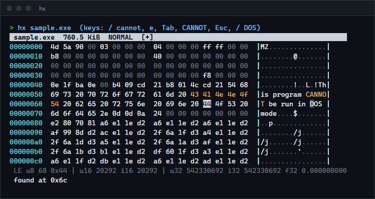
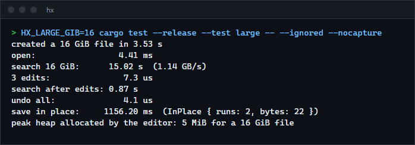

# hx

A terminal hex editor for files of any size. The file is memory-mapped and edits are kept in a piece table, so opening, inserting into and deleting from a 16 GiB file take milliseconds and microseconds and the editor allocates a few MiB of heap. For anyone who needs to inspect or patch big binaries, disk images or dumps without loading them.

**Status:** v0.1.0, working on Windows. The Linux build compiles but was not run. Not published to crates.io; build from source.



## Features

- Opens any file instantly (memory map) and never loads it; heap use does not grow with the file.
- Overwrite, insert, delete and append, by hex digits or by typing text (Tab switches).
- Undo and redo of up to 100,000 steps, with replace-all undone in one step.
- Search for text or for bytes (`x:de ad be ef`), forward and backward with wrap-around, over the edited content.
- Replace all (`find => replacement`), where the two sides may differ in length.
- Goto by hex or decimal offset, relative offsets, or the end of the file.
- Edited bytes are drawn in yellow; zeros are dim; the cursor is mirrored in the text column.
- A value inspector under the view shows the bytes at the cursor as u8, u16, u32, u64, signed, f32 and f64, little or big endian.
- Saves only the changed bytes in place when every edit kept the file length; otherwise it writes a temporary file and replaces the original.
- `--keys` replays a key sequence without a terminal and prints the screen, which is how the editor is tested.

## How to install

Requires a recent stable Rust (built and tested with 1.98.1).

```sh
git clone https://github.com/r3clusionn/hex-editor
cd hex-editor
cargo install --path .
```

This installs the `hx` binary.

## How to use

```sh
hx firmware.bin                 # open a file (created on save if it does not exist)
hx disk.img --offset 0x1be      # start at an offset
hx dump.bin --readonly          # no edits possible
hx dump.bin --columns 8         # fixed bytes per row (default: as many as fit, up to 16)
```

Editing is modal, like vim: `NORMAL` mode moves and runs commands, and `e`, `i` and `A` enter an edit mode where hex digits are data.

| Keys | What they do |
|---|---|
| `h j k l`, arrows, `PgUp` `PgDn`, `Home` `End`, `G` | Move, by byte, by row, by page, within the row, to the last byte. |
| `g` | Goto: `0x1f40`, `8000`, `+16`, `-0x10` or `$` (last byte). |
| `/` `?` `n` `N` | Search forward, backward, next, previous. Text as typed, or `x:de ad be ef` for bytes. |
| `e` / `i` / `A` | Overwrite, insert before the cursor, append at the end. Type two hex digits per byte; `Tab` switches to text entry; `Backspace` and `Delete` remove; `Esc` leaves. |
| `x`, `Delete` | Delete the byte under the cursor. |
| `u`, `Ctrl-r` | Undo, redo. |
| `R` | Replace all: `find => replacement` (an empty replacement deletes the matches). |
| `w` or `Ctrl-s`, `W` | Save, save as. |
| `E` | Toggle little and big endian values. |
| `q`, `Q` | Quit (refuses with unsaved changes), quit and discard. |
| `F1` or `H` | Key reference. |

### Replaying keys

`--keys` takes comma-separated key names and prints the final screen, so an editing session can be scripted, tested or put in a document. Names are single characters, `text:abc` (types the characters), `esc`, `enter`, `tab`, `space`, `comma`, `up`, `down`, `left`, `right`, `pgup`, `pgdn`, `home`, `end`, `backspace`, `delete`, `insert`, `f1` and `ctrl-x`. `--screen WxH` sets the size (default 80x24) and `--ansi` keeps the colours.

```sh
hx a.bin --keys "/,text:x:de ad,enter,e,f,f,esc,w" --screen 80x20
```

## How it works

- **A piece table.** The file is a list of pieces, each pointing at a range of the original file or of an append-only buffer of added bytes. Inserting splits one piece and adds one; deleting trims pieces; overwriting is a delete plus an insert. No file data moves, so the cost depends on the number of edits and not on the size of the file. Typing in a row extends one added piece instead of making a new one.
- **Undo** records, for each edit, the pieces that were replaced and the pieces that replaced them. Replace-all builds the new piece list in one pass and records one step.
- **Memory map.** The original is mapped read-only and read through the piece table, only for the rows on screen. Search reads the content in 4 MiB chunks, so it works at any size and sees the edits.
- **Saving.** If the length is unchanged and every original byte is still where it was, the added pieces are written into the file at their offsets, which touches only the changed bytes. Otherwise the whole content is streamed to `name.hx-tmp` in the same folder, the map is released (Windows cannot replace a mapped file) and the temporary file is renamed over the original. If the rename fails the map is restored and the edits stay pending.
- **The screen is data.** `App::render` returns lines of styled spans and `App::handle_key` is a plain state machine, so nothing in the editor needs a terminal; `src/term.rs` is a short crossterm loop around them.

## Measurements

A 16 GiB file created with `set_len` on an NTFS volume (zeros, with three markers), Intel Core i9-14900KF, Windows 11, Rust 1.98.1, release build, from `tests/large.rs` (run with `--ignored`). Heap use is counted by a global allocator wrapped around the system one, so it is the memory the editor allocates and does not include pages of the mapped file.



- **Open, edit, undo:** milliseconds and microseconds, independent of the file size.
- **Search of the whole 16 GiB:** 15 to 20 s on the first scan (three runs: 17.8, 19.9 and 15.0 s, about 1 GB/s) because every page is read in for the first time; scanning the second half again took about 1 s (8 GiB in 0.87 to 1.19 s, roughly 7 to 9 GB/s) with the pages already cached. Search speed is limited by reading the file, not by the substring search.
- **Save in place** of two changed runs (22 bytes) took 0.9 to 1.2 s. The save writes the runs and then flushes the file to disk; I did not break down where the time goes.
- **Heap:** a peak of 5 MiB for the 16 GiB file. The operating system counts the mapped pages it has read as the process's working set, so the working set reached the size of the file in a run that scanned all of it; those are clean pages of the file, not allocations.

## Verification

- `cargo test --release`: 15 unit tests, 5 command-line tests, 8 tests of saving, 3 model tests, 16 tests that drive the editor with keys, and the 16 GiB test above (ignored unless asked for).
- The model tests apply random insert, delete, overwrite, replace-many, undo, redo and save-marker steps to the piece table and to a plain `Vec<u8>`, and after every step compare the content, the length, which bytes count as modified, the saved flag and the table's invariants (about 56,000 steps over 74 seeds, with up to 5,000 bytes and thousands of pieces). This found a real bug while it was being written: `replace_many` recorded an undo step even when every replacement was empty, which put the undo stack out of step.
- I changed the piece table six ways to check that the model tests notice. Four were caught (modified flags ignoring moved bytes, undo not feeding redo, history trimmed to three steps, an edit that drops pieces). Two were not, and neither changes behaviour: skipping the check that an added piece is contiguous before merging (the merge step already refuses non-contiguous pieces), and treating an insertion at the end of the file as a split of the last piece (the content is the same).
- Saving is tested in place and by rewrite against the bytes on disk, with no temporary file left over, and on Windows a rename that fails (a read-only target) leaves the original file and the pending edits intact.
- The terminal loop is not covered by those tests, so it was run once in a real console window with real keystrokes (`x`, `l`, `e`, `f`, `f`, `Esc`, `w`, `q`): the file on disk had the expected bytes and the process exited with status 0.

## Limits

- Tested on Windows only. The Linux build was compile-checked for `x86_64-unknown-linux-musl` and not run.
- Search is synchronous: a scan of a huge file blocks the screen until it finishes and cannot be cancelled.
- Every key press is its own undo step, and the undo history is cleared when the file is saved.
- An in-place save is not atomic: a crash in the middle can leave some patches written and others not. A rewrite is atomic.
- Bytes typed or pasted into the editor stay in the added buffer for the life of the session, even after an undo.
- If another program changes or truncates the file while it is open, reading it can fail or show the new bytes.
- No selection, copy and paste, bookmarks, structure templates, checksums or mouse support.

## License

MIT (see `LICENSE`).
